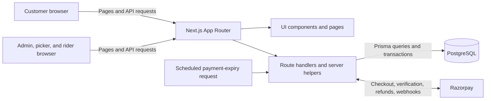

# Cut & Catch - Local Fish & Meat Delivery Platform

Cut & Catch is a full-stack storefront for ordering fresh fish, seafood, poultry, and mutton from a local counter. Customers can browse the catalog, choose product options, enter a delivery address, select a delivery window, and track orders. Staff use role-based pages to process orders and coordinate delivery.

## Project overview

Local food counters often take orders through disconnected channels and manage delivery availability manually. This project brings product browsing, checkout, delivery-slot reservations, and order operations into one web application.

The current catalog and delivery windows are sample data. Replace them with verified supplier, stock, service-area, and pricing information before any real customer launch.

## Features

### Customer

- Create an account and sign in or out.
- Save a phone number and default delivery address in the account page; saved details prefill checkout.
- Browse product categories and search by name.
- View product details and choose available weights, packs, and preparation options.
- Add products to a browser-persisted cart.
- Submit a live order with an address, PIN code, delivery window, and cash-on-delivery payment.
- View order history and a status timeline.
- Request a return review for an eligible delivered online order.

### Staff operations

- Admins and managers can review orders, update allowed statuses, and assign riders after packing.
- Pickers can accept, pick, and pack assigned orders.
- Riders can see assigned deliveries, update delivery status, and confirm cash collection for COD orders.
- Dashboard metrics provide basic order counts.

### Catalog and product management

- The catalog includes sample fish, seafood, poultry, and mutton products, including farm-fresh eggs.
- Product weights or pack options, prices, images, origins, and preparation options are defined in the demo catalog and database seed.
- Product and category records cannot currently be managed through an admin CRUD screen. Update the seed/catalog and reseed during development, or implement the missing management workflow.

### Order and delivery

- Checkout validates order fields and checks item availability.
- Database-backed checkout reserves product stock and a delivery slot transactionally.
- Delivery-window lookup is PIN-code based. The sample seed creates windows for PIN 110001.
- Order status history is visible to customers and staff.

### Payments

- Cash on delivery is available for live database-backed checkout.
- Razorpay order creation, verification, webhook, expiry, and refund routes are implemented behind server configuration.
- Provider checkout and webhook processing require test credentials and a public HTTPS webhook endpoint; they have not been verified end to end.
- Late Razorpay captures on cancelled orders need a manual refund path. Do not treat payment integration as production-ready until this case is resolved and tested.

## Technology stack

- Next.js 16 App Router and React 19
- JavaScript ES modules
- Prisma ORM 7 with PostgreSQL
- NextAuth credentials authentication and JWT sessions
- Zod request validation and bcryptjs password hashing
- Razorpay Standard Checkout integration
- React Three Fiber and Three.js for the homepage scene
- Motion for interface animation and Lucide React icons
- ESLint and Node.js built-in test runner
- Docker Compose with PostgreSQL 17 for local development

## Architecture

The Next.js application serves both the web UI and HTTP API. Server components and client components share the same application; route handlers call server-side auth, catalog, order, payment, and database helpers. Prisma connects the application to PostgreSQL. Razorpay is an optional external payment provider.

## Project structure

    src/app/                 App Router pages, layouts, and API routes
    src/app/api/v1/           Versioned REST endpoints
    src/components/           Storefront, cart, checkout, and operations UI
    src/lib/                  Shared catalog and pricing helpers
    src/server/               Authentication, database, orders, and payments
    prisma/schema.prisma      PostgreSQL data model
    prisma/migrations/        Database migration history
    prisma/seed.js            Sample catalog, delivery slots, and optional staff
    public/images/            Product and homepage imagery
    tests/unit/               Unit tests
    tests/integration/        PostgreSQL-backed capacity test

Generated Prisma client files are created under src/generated/prisma and are intentionally excluded from version control.

## Installation and local setup

Requirements: Node.js 20.9 or newer, npm, and Docker Desktop or another PostgreSQL 17 server.

1. Clone the repository.

       git clone <your-repository-url>
       cd local-fish-meat-delivery-platform

2. Install the locked dependencies.

       npm ci

3. Create the local environment file.

       cp .env.example .env

   Set a unique AUTH_SECRET, for example with:

       openssl rand -base64 32

   The example database URL and Docker Compose credentials are for local development only. Do not reuse them in a hosted environment.

4. Start the local database.

       docker compose up -d

5. Generate the Prisma client, apply migrations, and load sample data.

       npm run db:generate
       npm run db:migrate
       npm run db:seed

   Sample live delivery windows are seeded for PIN 110001. Local development uses clearly marked demo windows for any PIN matching the six-digit Indian format, so checkout can be previewed without seeding a matching area. The seed also creates staff accounts only when their corresponding email and non-placeholder password variables are set.

6. Start the application.

       npm run dev

7. Open http://localhost:3000.

To stop the local database, run docker compose down. The named database volume is retained. Do not delete it if you need to keep local orders.

## Environment variables

Copy .env.example to .env and keep .env out of Git. Never put production secrets in a browser-visible NEXT_PUBLIC variable.

| Variable | Purpose |
|---|---|
| DATABASE_URL | PostgreSQL connection URL for the app and Prisma |
| POSTGRES_PASSWORD | Local Docker Compose database password; keep it consistent with DATABASE_URL |
| TEST_DATABASE_URL | Separate disposable PostgreSQL URL for the slot-capacity integration test |
| AUTH_SECRET | Secret used to sign authentication tokens |
| AUTH_TRUST_HOST | Enables host trust for local NextAuth setup; deploy only behind a correctly configured host/proxy |
| NEXTAUTH_URL | Base URL used by authentication callbacks |
| NEXT_PUBLIC_SITE_URL | Public site base URL |
| NOMINATIM_BASE_URL | Server-side address search and reverse-geocoding service; defaults to Nominatim |
| OSM_TILE_URL | Server-side map tile URL template; defaults to OpenStreetMap's standard raster tiles |
| DEMO_ADMIN_EMAIL / DEMO_ADMIN_PASSWORD | Optional local seed credentials for an admin |
| DEMO_PICKER_EMAIL / DEMO_PICKER_PASSWORD | Optional local seed credentials for a picker |
| DEMO_RIDER_EMAIL / DEMO_RIDER_PASSWORD | Optional local seed credentials for a rider |
| RAZORPAY_KEY_ID | Razorpay key ID, read on the server and used to initialize checkout |
| RAZORPAY_KEY_SECRET | Server-only Razorpay API secret |
| RAZORPAY_WEBHOOK_SECRET | Server-only secret for webhook signature validation |
| PAYMENT_CLEANUP_SECRET | Bearer secret for the payment-expiry endpoint |

Use test-mode Razorpay credentials during staging. Never expose the key secret, webhook secret, or cleanup secret to client code.

## Map and address selection

Checkout uses Leaflet for the interactive map. Map tiles are served through `/api/v1/map-tile` and cached; search and reverse-geocoding requests go through `/api/v1/geocode` to Nominatim, where results are cached and uncached requests are spaced at least one second apart. OpenStreetMap attribution is shown on the map. The default tile and geocoding services are provided on a best-effort basis and have usage limits; switch `OSM_TILE_URL` and `NOMINATIM_BASE_URL` to compatible services before using the public defaults for higher-traffic production workloads. See the [OpenStreetMap tile policy](https://operations.osmfoundation.org/policies/tiles/) and [Nominatim usage policy](https://operations.osmfoundation.org/policies/nominatim/).

When `NODE_ENV=development`, checkout offers sample windows for any PIN matching the six-digit Indian format and saves a demo order only in the current browser. It does not arrange delivery or take payment. Production with a configured database only offers real windows seeded for active delivery areas and available capacity; a correctly formatted PIN can still be outside configured coverage.

For a production build served locally, set `CUT_CATCH_LOCAL_DEMO=true` in `.env` to use those sample windows for every valid six-digit PIN on `localhost`, `127.0.0.1`, or `::1`. The switch is restricted to loopback hosts; requests to other hosts continue to use database-backed service areas and real delivery slots. Demo orders remain in the current browser and do not arrange delivery or take payment.

## API overview

All application APIs are Next.js route handlers. Request validation and authentication rules are enforced in the handlers.

| Method | Endpoint | Purpose |
|---|---|---|
| GET | /api/v1/catalog | Return active products and variants |
| GET, PATCH | /api/v1/profile | Read or update the signed-in customer's own phone and saved delivery details |
| GET | /api/v1/geocode?q=... or /api/v1/geocode?lat=...&lon=... | Search or reverse-geocode an Indian address for checkout |
| GET | /api/v1/map-tile?z=...&x=...&y=... | Fetch a cached map tile for checkout |
| POST | /api/v1/auth/register | Register a customer account |
| GET | /api/v1/delivery-slots?postalCode=110001 | List available delivery windows for a PIN |
| POST | /api/v1/checkout | Validate and create a live order; reserves stock and slot capacity |
| GET | /api/v1/orders/{id} | Retrieve an order visible to the signed-in customer or authorized staff |
| POST | /api/v1/orders/{id}/return | Request review for an eligible delivered online order |
| POST | /api/v1/admin/orders/{id}/transition | Apply an allowed staff order-status transition |
| POST | /api/v1/admin/orders/{id}/assignment | Assign a rider to an eligible order |
| POST | /api/v1/admin/orders/{id}/refund | Initiate an eligible full Razorpay refund |
| POST | /api/v1/payments/razorpay/verify | Verify a Razorpay payment callback |
| POST | /api/v1/payments/razorpay/webhook | Receive signed Razorpay events |
| POST | /api/v1/payments/expire | Release expired payment reservations; requires the cleanup bearer secret |
| GET, POST | /api/auth/[...nextauth] | NextAuth authentication handlers |

## Checks

Run the available project checks with:

    npm run lint
    npm test
    npm run build

The test script generates the Prisma client before running Node tests. The delivery-slot concurrency integration test requires TEST_DATABASE_URL to point to a separate migrated, disposable database. It is skipped when that variable is unset. Never point it at production data.

The build script generates the Prisma client and runs the Next.js production build.
The current layout downloads DM Sans and Playfair Display through next/font/google during the build, so the build environment needs access to fonts.googleapis.com. Self-host licensed font files if offline or hermetic builds are required.

## Screenshots

No application screenshots are included in the repository. Add genuine screenshots under docs/screenshots/ before release, for example:

- Storefront and category browsing
- Product detail and cart
- Checkout with a seeded delivery window
- Customer order tracking
- Admin order operations
- Picker and rider views

Do not use product imagery as a substitute for application screenshots.

## Deployment

### Render free college-project deployment

The root `render.yaml` is a Render Blueprint for this full-stack Next.js app. It provisions a Node web service and PostgreSQL database in Singapore, generates `AUTH_SECRET`, applies Prisma migrations, seeds the sample catalog and delivery windows, and starts the app. `NEXTAUTH_URL` and `NEXT_PUBLIC_SITE_URL` are linked to Render's assigned HTTPS URL. Local demo mode stays off on the hosted site.

To deploy, push the repository to GitHub, open Render's Dashboard, choose **New > Blueprint**, connect this repository, and deploy the Blueprint. Render then automatically deploys later commits to the linked branch.

This uses Render's free instances for a college/demo project. The web service sleeps after 15 minutes without traffic and can take about a minute to wake. The free PostgreSQL database is limited to 1 GB and expires after 30 days; after its grace period Render deletes its data. Do not use this free database for durable customer/order data. The sample seed currently enables checkout delivery windows only for PIN `110001`; configure actual zones before presenting live delivery coverage. Razorpay is not configured, so checkout uses cash on delivery.

Render free-tier limits can change; see [Render's free instance details](https://render.com/docs/free). A real customer launch needs durable managed PostgreSQL, verified delivery areas and operating data, payment credentials, backups, monitoring, and a scheduled call to the payment-expiry endpoint.

## Known limitations and future improvements

- Add admin product, category, customer, inventory, and delivery-slot management.
- Add saved customer profiles and addresses, customer cancellation, and order notifications.
- Add product filtering and sorting.
- Revalidate staff roles promptly and restrict order data to the minimum required for each staff role.
- Add a refund path for late payment captures on cancelled orders.
- Configure and acceptance-test Razorpay test-mode checkout and webhook handling.
- Add automated browser journeys, mobile viewport checks, performance measurements, and deployment monitoring.
- Replace sample prices, stock, product origins, delivery PINs, and delivery policies with verified operating data.

## Author and license

Author details and license preference have not been supplied. Add the project owner's name and profile links, and choose a license, before presenting this repository as an open-source release.
